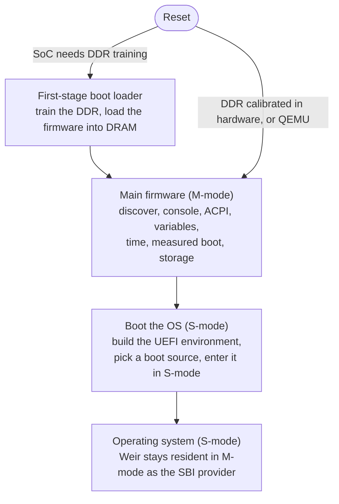

# Boot flow

This is the path from reset to a running operating system. Each stage has its own
doc for the detail. This one shows how they fit together.



## Stage 1: first-stage boot loader

When the SoC needs the CPU to train its DDR, the first-stage boot loader (FSBL)
runs first. It trains the DDR, copies the main firmware from flash into DRAM,
measures it, and jumps to it. A SoC that calibrates its DDR in hardware, and
QEMU, skip this stage and start the main firmware directly. See
[fsbl.md](fsbl.md).

## Stage 2: main firmware bring-up

The main firmware starts in M-mode at its reset vector, which clears `.bss` and
calls the bring-up. Only the boot hart runs it. The other harts wait for the SBI
to start them. The bring-up runs in this order:

1. **Discover the platform.** Read the device tree and find the peripheral
   addresses. This happens before the console, so the console uses the UART the
   tree reports.
2. **Console.** Bring up the UART and print the banner.
3. **ACPI.** Build the ACPI tables, or read the tables QEMU prepared. See
   [acpi.md](acpi.md).
4. **Variables.** Bring up the UEFI variable store, backed by flash when present.
5. **Time.** Bind an RTC, or start a software clock at the UNIX epoch.
6. **Measured boot.** Start the TPM and measure the firmware into PCR 0. If the
   FSBL already measured it, record that digest instead. See
   [measured-boot.md](measured-boot.md).
7. **Storage.** Discover the block devices: virtio-blk, an SD host, or an SD card
   on each SPI master.

## Stage 3: boot the operating system

The firmware builds the UEFI environment: the System Table, the Boot and Runtime
Services, and the configuration table with the ACPI, SMBIOS, and device-tree
pointers. See [uefi.md](uefi.md).

It then tries the boot sources in priority order:

1. The boot manager, which finds an ESP, mounts FAT, and honours the boot
   variables, an extlinux file, or the removable-media fallback. See
   [Boot a kernel from an extlinux file](#boot-a-kernel-from-an-extlinux-file).
2. An embedded PE application.
3. An embedded S-mode ELF payload.

The firmware loads the chosen image and enters it in S-mode, with the boot hart
ID and the device-tree pointer. If no source works, it halts.

## Boot a kernel from an extlinux file

The boot manager can start a Linux kernel directly from an extlinux
configuration file, with no boot loader between Weir and the kernel. On a board
with little RAM, this saves the memory and the time of a boot loader.

### Where Weir looks

On each device, the boot manager mounts the FAT ESP and tries these choices in
order:

1. The file that the `BootOrder` and `Boot####` variables select.
2. `\extlinux\extlinux.conf`, then `\boot\extlinux\extlinux.conf`.
3. The removable-media fallback `\EFI\BOOT\BOOTRISCV64.EFI`.

When a `Boot####` variable selects a file, Weir uses only that file on this
device. If the file is missing, Weir goes to the next device. Weir tries the
extlinux file only when no variable selects a file.

When the extlinux entry cannot be used, Weir prints one `[boot] extlinux:` line
that gives the reason and tries the fallback. When there is no extlinux file,
Weir prints nothing for it.

### The keys Weir reads

- `default <label>` selects the entry. With no `default`, or with a `default`
  that names no label, Weir uses the first `label`.
- `label <name>` starts an entry.
- `kernel <path>` or `linux <path>` gives the kernel.
- `initrd <path>` gives the initrd. Weir uses only the first initrd.
- `append <args>` gives the kernel command line.

Keywords are not case sensitive. A path that starts with `/` starts at the root
of the ESP. Other paths start at the directory of the configuration file. A
`..` that goes above the root is an error. The file can be at most 16 KiB, and
a line at most 1024 bytes.

Weir ignores the menu keys, such as `timeout`, `prompt`, `menu`, `ui` and
`ontimeout`. It also ignores `fdt`, `fdtdir`, `devicetree` and `fdtoverlays`,
because Weir gives the kernel its own device tree. It does not support
`include`.

### The kernel

The kernel must have the EFI stub, because Weir loads it as a PE image. When the
image does not fit in the first image window, the large memory layout loads it
in RAM above the file staging buffer. Weir reads the initrd into the page pool,
at the first 2 MiB boundary after the kernel, and gives it to the stub through
`LoadFile2`. In the large memory layout, a kernel in the first image window
ends below the page pool, and the initrd then starts at the start of the page
pool. If the initrd does not fit in RAM, the kernel boots without it.
The `append` text becomes the load options of the kernel image. With no
`append`, the kernel gets no load options.

Weir measures the configuration file and the command line into PCR 5, and the
kernel and the initrd into PCR 4.

### Example

```
default nixos
timeout 30

label nixos
  linux ../nixos/kernel.efi
  initrd ../nixos/initrd
  append console=ttyS0 earlycon=sbi root=/dev/vda2
```

Weir prints these lines when it boots this entry:

```
[boot] extlinux: \extlinux\extlinux.conf, label nixos
[boot] extlinux: kernel \nixos\kernel.efi, 43551232 bytes
[boot] ESP published via Simple File System
[boot] extlinux: append console=ttyS0 earlycon=sbi root=/dev/vda2
[boot] extlinux: initrd \nixos\initrd, 25839441 bytes
```

## After hand-off

The operating system runs in S-mode. Weir stays resident in M-mode as the SBI
provider. When the OS makes an `ecall`, the trap handler routes it to the SBI,
which services it and returns to S-mode. See [sbi.md](sbi.md).
